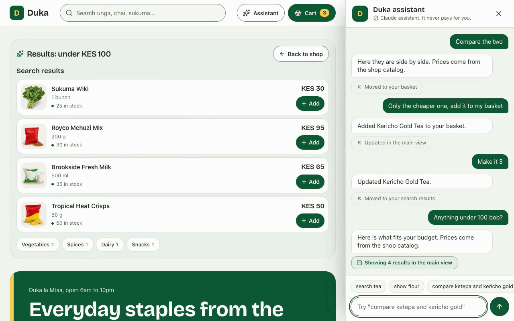

# Duka Assistant

Duka is a small web shop for a Kenyan duka (corner shop) with a generative-UI shopping assistant. You ask for things in plain words ("show flour", "compare ketepa and kericho gold", "Anything under 100 bob?") and the assistant answers by rendering A2UI cards: product grids, comparison tables, a basket summary, a checkout handoff. It never writes free HTML or free text into the page. Every card comes from a small trusted component catalog, every message is schema-checked before it renders, and the assistant can never pay for you.



*The shopper asks "Anything under 100 bob?" in the chat on the right. The answer renders as a card in the main area: four products under KES 100, priced from the shop catalog, with category chips.*

Live demo: https://duka-assistant-vert.vercel.app

The hosted demo may answer in scripted mode (the local rule-based planner) when live Claude is off, rate limited or out of budget. Until its shared spend store is connected it fails closed and answers in scripted mode only.

## Features

These all exist in the code today.

- **Shop**: a catalog of 13 everyday products in 11 categories (flour, tea, sugar, dairy, vegetables and so on) on the home page, a product page per item (`/p/[slug]`), and header search.
- **Basket**: add, change quantity and remove on the cart page (`/cart`). The cart lives on the server per session.
- **Checkout with a mock M-Pesa flow**: `/checkout` takes a phone number and the shopper taps Pay. A mock STK push follows: pending, then paid, failed or cancelled (the outcome depends on the last digits of the phone, for testing). The order page (`/orders/[id]`) polls the order status. No real money moves.
- **Assistant panel**: an "Assistant" button in the header of every page opens the chat. From 1024 px wide it is a side drawer and the shop stays usable; below that it is a full-height sheet.
- **Assistant canvas in the main area**: the assistant's cards render at the top of the main column, not inside the chat. The chat holds only the conversation plus a short pointer line ("Showing 4 results in the main view"). A "Back to shop" button hides the canvas. The canvas shows a skeleton while a request is in flight.
- **Card types** (the whole trusted catalog, 8 components): ProductGrid, ProductCard, CompareTable, CartSummary, QuantityStepper, FilterChips, CheckoutHandoff, OrderStatusCard.
- **What you can ask**:
  - search and browse: `search tea`, `show flour`
  - compare: `compare ketepa and kericho gold`
  - basket edits: `add 2 unga`, `set unga to 3`, `remove unga`, `show cart`
  - checkout handoff: `checkout` (opens a card with a "Go to checkout" button; you still tap Pay yourself)
  - order status: `order status`, `where is my order`
  - with the Claude planner, also budget search (`Anything under 100 bob?`) and follow-ups that refer to what is on screen (`only the cheaper one`, `add it`, `make it 3`, `remove that`). The scripted planner does not understand budgets or follow-ups.
- **Follow-ups update cards in place**: with the Claude planner, a follow-up replaces the matching card on screen instead of stacking a new one, and the old turn's pointer line changes to "Updated in the main view" or "Moved to your basket".
- **Category chips**: FilterChips are built by the server from the products actually shown, so counts always match the grid.
- **Mobile layout**: on narrow screens the canvas sits above the catalogue, the chat is a bottom sheet that closes after an answer with cards, and a floating "Chat" handle reopens it. Checked at 390 px and 1280 px wide.
- **Accessibility**: labelled inputs and buttons, Escape closes the assistant and focus returns to the button, new answers are announced through an `aria-live` region, quantity changes are announced politely, product images have alt text, and smooth scrolling and the canvas fade are off when the system asks for reduced motion.

## How it works

Next.js 15 App Router, React 19, TypeScript (strict), Tailwind CSS 4. The A2UI renderer is `@a2ui/web_core` (strict message processor) with `@a2ui/react`. The Claude client is `@anthropic-ai/sdk`. Inputs are checked with zod.

```
 shopper text
      |
      v
 POST /api/assistant  (300 char cap, 4 KB body cap, same origin)
      |
      v
 planner ------------------------------------------------+
   |  scripted: regex planner (default, no keys)          |
   |  claude:   tool loop with MCP-shaped tools           |
   |            gate -> per-IP rate limit -> spend guard  |
   |            any failure falls back to scripted        |
   v                                                      |
 A2UI messages <------------------------------------------+
      |
      v
 validate on the server (trusted catalog, strict schemas)
      |
      v
 panel: validate again, then render in the main-area canvas
      |
      v
 card buttons -> POST /api/assistant/action (8 allowlisted actions, no pay)
```

### Two planners

- **Scripted planner** (`lib/assistant/planner.ts`, the default): a deterministic, rule-based planner. It maps shopper text to A2UI messages with regular expressions. No network, no model, no keys, and the same input always gives the same answer.
- **Claude planner** (`lib/assistant/claude/`): off by default. It runs a tool loop (`loop.ts`). The model calls data tools, the server answers them from the real catalog and cart, and the model finishes with one `render_ui` call. Caps per shopper message: 4 model requests, 8 tool calls, 1024 max tokens, a 20 second timeout and no SDK retries. Short conversation memory (last 6 turns per session, in memory) lets follow-ups work.

### MCP-shaped tools

`lib/assistant/tools/definitions.ts` defines the tools in the MCP tool shape (name, description, JSON schema): `search_products`, `list_products`, `get_product`, `view_cart`, `add_to_cart`, `update_cart_quantity`, `remove_from_cart`, `place_mock_order`, `list_orders`, plus `render_ui`. Every input is parsed again with a strict zod schema in `lib/assistant/tools/handlers.ts`. `list_products` and `search_products` take a `maxPriceKES` budget and the shop filters by its own prices. A budget card is accepted only if a tool call in the same turn used the budget and every product shown is within it by catalog price.

### A2UI and the trusted catalog

- `lib/a2ui/catalog-api.ts` defines the 8 components, each with a strict zod schema. There is no free display text: every prop is a catalog id, an enum, a child list, an allowlisted action or a trusted text key (`lib/a2ui/trusted-text.ts`), and our code writes the words. Product names, prices and stock are looked up from the catalog by id, so a model cannot invent a price or a URL.
- `lib/a2ui/validate.ts` runs on the server before sending and again in the browser before render. It rejects unknown components, unknown or invalid props, unknown or pay-like actions, URL-like or HTML strings, oversized batches, too many messages or components, and deep trees. It then runs the `@a2ui/web_core` strict processor as a second check. A rejected reply shows a fixed fallback card ("I could not show that.") and leaves the canvas as it was.
- `lib/a2ui/actions.ts` allows 8 card actions: `add_to_cart`, `set_quantity`, `remove_from_cart`, `apply_filter`, `compare`, `show_cart`, `go_to_checkout`, `show_order`. Each has a strict payload schema and a server handler.

### The assistant can never pay

There is no pay tool and no pay action. `place_mock_order` only returns a checkout handoff. `go_to_checkout` only navigates to `/checkout`. The only caller of the (mock) STK push is the Pay button's server action in `app/checkout/actions.ts`. Tests enforce this: a static import-graph check that no assistant file can reach the payment code, and runtime checks that drive every handler with hostile input.

### Spending guard for live Claude

- **Reserve, then settle**: before each model request the spend guard (`lib/assistant/claude/spend.ts`) reserves a worst-case cost estimate. If spent plus reserved plus the estimate would pass the cap, the call is refused with no network traffic. After the response the reservation is replaced by the real cost from the usage numbers. On a timeout or API error the reservation is kept as spent, because the request may have been billed.
- **$5 hard cap**: `HARD_CAP_USD` is 5.00. `DUKA_SPEND_CAP_USD` can only lower it.
- **Local ledger**: a JSON file under `.duka-spend/` with atomic writes and a lock file for several processes on one machine.
- **Shared ledger for hosting** (`lib/assistant/claude/store.ts`): on a multi-instance host the cap lives in Upstash Redis, reached over its REST API with plain `fetch`. Reserve and settle run as atomic Lua scripts, money is stored as integer micro-dollars, and each reservation has a 120 second TTL so a crashed instance's reservation is swept and kept as spent.
- **Fail closed**: on Vercel (or with `DUKA_LEDGER=shared`) the store is required. A missing store config, a store error or a store timeout (2 seconds) means no model request at all; the shopper gets the scripted answer with a "live unavailable" note.
- **Per-IP rate limit**: 5 live prompts per minute and 40 per UTC day per IP, kept in the shared store. The IP is stored only as an HMAC, and IPv6 addresses are counted per /64. Over the limit the shopper gets the scripted answer.
- **Prompt cap**: prompts over 300 characters are rejected before any planner runs (`MAX_PROMPT_CHARS` in `lib/assistant/http.ts`).

### Key files

| Path | What |
| --- | --- |
| `app/` | Pages (`/`, `/p/[slug]`, `/cart`, `/checkout`, `/orders/[id]`) and API routes (`/api/assistant`, `/api/assistant/action`, `/api/assistant/mode`, `/api/cart`, `/api/orders/[id]/status`, `/api/mock/daraja/resolve`) |
| `components/assistant/` | Assistant button, drawer, panel, turns, canvas and the React views for the 8 cards |
| `lib/catalog.ts` | The static product catalog |
| `lib/shop/` | Cart, orders, sessions, phone numbers, checkout token, origin check |
| `lib/a2ui/` | Trusted catalog, validator, actions, trusted text, panel gate |
| `lib/assistant/planner.ts` | Scripted planner |
| `lib/assistant/claude/` | Claude planner: config and live gate, client, tool loop, memory, mock client, spend guard, shared store |
| `lib/assistant/tools/` | Tool definitions and handlers |
| `lib/daraja/` | Mock M-Pesa adapter (used) and Daraja sandbox code (parked) |
| `scripts/` | Spend report and ledger CLI, client bundle check, parked sandbox smoke test |

## Quick start

Prerequisites: Node.js 22.12 or newer (current LTS is fine) and pnpm 10.

```bash
pnpm install
pnpm dev
```

Open http://localhost:3200. The dev server runs on port 3200. This runs the scripted planner and needs no keys and no network.

Try these in the assistant:

- `search tea`
- `show flour`
- `compare ketepa and kericho gold`
- `add 2 unga`, then `set unga to 3`, then `show cart`
- `checkout`
- `order status`
- `help`

To try the Claude planner without a key or any network call, run it against the recorded fixtures:

```bash
DUKA_PLANNER=claude DUKA_PLANNER_CLIENT=mock pnpm dev
```

The fixtures (`tests/fixtures/claude`, mapped in `lib/assistant/claude/mock-client.ts`) cover prompts such as `search tea`, `compare ketepa and kericho gold`, `Anything under 100 bob?`, `show flour`, then `only the cheaper one`, `add it`, `make it 3`, `remove that`, plus `checkout please` and `where is my order`. There are also hostile fixtures (`hostile link`, `hostile pay`, `hostile component` and others) that show the validator rejecting bad output. Other text falls back to the scripted planner.

For a production build: `pnpm build`, then `pnpm start` (also port 3200).

## Configuration

Set these as environment variables (or in a local `.env`, which is gitignored). Names only; never commit values. `.env.example` lists the common ones with empty placeholders.

| Variable | Purpose | Default |
| --- | --- | --- |
| `DUKA_PLANNER` | `regex` (scripted) or `claude` | `regex` |
| `DUKA_ASSISTANT_MODE` | Legacy switch: `mock` means regex, `model` means claude. `DUKA_PLANNER` wins when both are set | unset |
| `DUKA_PLANNER_CLIENT` | `mock` uses the fixture client and never touches the network. Always wins over live | unset |
| `DUKA_ALLOW_LIVE` | Must be exactly `1` to allow live Claude calls | unset (off) |
| `ANTHROPIC_API_KEY` | Claude API key, read on the server only | unset |
| `DUKA_CLAUDE_MODEL` | Model id; must look like `claude-...` and be in the spend guard's price table | `claude-sonnet-5-5` |
| `DUKA_CLAUDE_THINKING` | `between_tools`, `adaptive`, `off` or `omit` | `between_tools` |
| `DUKA_CLAUDE_EFFORT` | `low`, `medium`, `high` or `omit` | `low` |
| `DUKA_CLAUDE_MAX_TOKENS` | Can only lower `max_tokens` (floor 256) | 1024 |
| `DUKA_CLAUDE_CACHE` | `1` turns on prompt caching for the system prompt and tools | off |
| `DUKA_LIVE_TRACE` | `1` logs request and response shapes only (no text, no key) | off |
| `DUKA_SPEND_CAP_USD` | Can only lower the $5 cap. Junk or negative means 0 | 5.00 |
| `DUKA_SPEND_DIR` | Directory of the local file ledger | `.duka-spend/` |
| `DUKA_SPEND_ORIGIN` | Tag for per-origin totals in the ledger | `app` |
| `DUKA_LEDGER` | `shared` forces the shared store (and makes it required) | unset |
| `DUKA_LEDGER_NAMESPACE` | Key prefix in the shared store | `duka` |
| `KV_REST_API_URL`, `KV_REST_API_TOKEN` | Upstash Redis REST endpoint and token (names set by the Vercel Upstash integration) | unset |
| `UPSTASH_REDIS_REST_URL`, `UPSTASH_REDIS_REST_TOKEN` | Alternative names, used only when the KV pair is not set | unset |
| `DUKA_RATE_PER_MIN`, `DUKA_RATE_PER_DAY` | Can only lower the per-IP limits | 5 and 40 |
| `DUKA_MOCK_DELAY_MS` | Delay before the mock payment resolves | see `.env.example` |
| `DUKA_PUBLIC_ORIGIN` | Public origin for the checkout same-origin check (for example behind a proxy) | from request headers |
| `DUKA_INSECURE_COOKIES` | Allows non-https session cookies in a production build, for local e2e runs | unset |
| `DUKA_ASSISTANT_TEST_HOOKS` | Test only: exposes an injection hook for the e2e (mock mode only) | unset |
| `DUKA_SPEND_TEST_PRICE_MOCK` | Test only: prices the fixture client through the spend guard | unset |
| `DUKA_DARAJA_MODE`, `DUKA_DARAJA_ENV_FILE`, `DUKA_CALLBACK_SECRET`, `DUKA_DARAJA_QUIET` | Parked Daraja sandbox code, not used by the app | unset |

`VERCEL`, `VERCEL_ENV` and `AWS_LAMBDA_FUNCTION_NAME` are read (not set by you) to detect a hosted run.

## Scripted vs live mode

**Scripted** is the default. Nothing to configure, no cost.

**Live** Claude runs only when all of these are true (`liveGate()` in `lib/assistant/claude/config.ts`):

1. `DUKA_PLANNER=claude` is set explicitly.
2. The process is not a test run (`NODE_ENV` is not `test`, not under vitest).
3. `DUKA_PLANNER_CLIENT` is not `mock`.
4. `DUKA_ALLOW_LIVE` is exactly `1`.
5. `ANTHROPIC_API_KEY` is set and not blank.

The client checks the gate again on every request and only talks https to `api.anthropic.com`.

What happens when something is missing or goes wrong:

- **No key or live not allowed**: the Claude planner uses the fixture client if `DUKA_PLANNER_CLIENT=mock` and the text has a fixture, otherwise the scripted planner answers. The panel subtitle says "Claude is not connected, so a scripted fallback answers."
- **API error, timeout, refusal, malformed output or a cap hit**: the scripted planner answers. Basket changes made by tools during that turn are rolled back unless the card was accepted.
- **Spend cap reached**: the call is refused before any network traffic, the scripted planner answers, and the panel shows "Live Claude is paused (spend cap reached). Using the scripted helper."
- **Rate limited or busy**: the scripted answer, plus a short note. There is also an in-memory limit of 6 live runs per session and 30 per server process per minute.
- **Shared store missing or failing on a host**: no model call, the scripted answer, and a "live unavailable" note.

The cap is admission control on worst-case estimates, so the final total can end a little over the reservation in rare cases. Keep a spend limit on your Anthropic account as a backstop.

## Hosting on Vercel

Vercel runs many instances with no shared memory or disk, so the local file ledger cannot hold the cap there. The shared ledger and the per-IP rate limit use Upstash Redis over REST.

1. Add an Upstash Redis database through the Vercel integration. It sets `KV_REST_API_URL` and `KV_REST_API_TOKEN`. Keep eviction off on that database: an evicted ledger key would reset the spent total to 0.
2. Set `DUKA_PLANNER=claude`, `DUKA_ALLOW_LIVE=1` and `ANTHROPIC_API_KEY` for live mode, plus `DUKA_LEDGER=shared` as a belt-and-braces switch. All server-side only, never `NEXT_PUBLIC_`.
3. Optional: `DUKA_SPEND_CAP_USD`, `DUKA_RATE_PER_MIN`, `DUKA_RATE_PER_DAY` (all can only lower the limits), `DUKA_LEDGER_NAMESPACE`.
4. To carry over money already spent elsewhere, seed an empty namespace once from your machine with the store variables exported: `pnpm ledger:seed --spent-usd <amount>`. It refuses if the namespace already has a ledger.
5. Check the ledger at any time with `pnpm spend` (it reports whichever ledger is active and never prints a URL, token or key).

The store is required whenever `VERCEL`, `VERCEL_ENV` or `AWS_LAMBDA_FUNCTION_NAME` is set, or `DUKA_LEDGER=shared`. Without it the app fails closed: no model calls, scripted answers only.

Operator notes:

- The per-IP limit trusts proxy headers (`x-forwarded-for`, then `x-real-ip`). Vercel sets them. On another host a client could forge them and skip the per-IP limit; the $5 cap still holds.
- Cart, orders and conversation memory are still in memory per instance, so two requests from one shopper can land on different instances and see different baskets. Only the money cap and the per-IP limit are shared.
- `next build` needs no key and no store. No `vercel.json` is needed.

## Testing

| Command | What it does |
| --- | --- |
| `pnpm typecheck` | `tsc --noEmit` |
| `pnpm test` | Vitest unit, guard, injection and race tests: 847 tests in 42 files, all passing at the time of writing. A network guard blocks any call to Anthropic during tests, and fakes stand in for the Redis store |
| `pnpm e2e` | Browser tests of the shop, the assistant panel (1280 and 390 wide) and the Claude planner with fixtures (no network). Needs `pnpm build` first; each script starts and stops `pnpm start` on port 3200 itself |
| `pnpm check:bundle` | After `pnpm build`: checks that the client bundle in `.next/static` holds no API key or store names |

For `pnpm e2e` you need Playwright and Chrome:

- Playwright: set `DUKA_PLAYWRIGHT_PATH` to a Playwright package directory, or make `playwright` resolvable from the project (it is not a project dependency).
- Chrome: set `DUKA_CHROME_PATH` to your Chrome binary. The default is `/usr/bin/google-chrome` (Linux).

## Project structure

```
app/          Next.js pages and API routes
components/   Shop UI and the assistant panel and canvas
lib/          Catalog, shop logic, A2UI catalog and validator, planners, spend guard, mock payments
public/       Product images
scripts/      Ledger CLI, spend report, client bundle check, parked sandbox smoke test
tests/        Vitest tests, fixtures for the Claude mock client, fakes
e2e/          Playwright browser tests
docs/         Screenshot and product image prompts
```

The specs the app was built against are in `SPEC.md`, `SPEC-WEEK2.md`, `SPEC-CLAUDE-PLANNER.md` and `SPEC-LIVE.md`.

## Limits and safety

- **Checkout and payment are mocks.** The M-Pesa STK push is simulated; no real charge ever happens.
- **The assistant never pays.** It can fill the basket and open checkout, but only the shopper's tap on Pay starts the (mock) payment.
- **The Daraja sandbox code is parked.** The sandbox adapter, env loader, callback route and `scripts/sandbox-smoke.ts` are kept in the repo but the app never uses them; it always uses the mock adapter.
- **Live mode costs real money.** Every live prompt is a paid Claude API call. It is capped at $5 in total per ledger, plus per-IP and per-session limits.
- **Anyone with a hosted link can spend up to the cap.** The cap stops the spending, not the access. Once it is reached the demo falls back to scripted answers.
- **The catalog is a static mock** of 13 products in `lib/catalog.ts`. Cart, orders and sessions are in memory and are lost on restart.

## License

MIT, see LICENSE.
